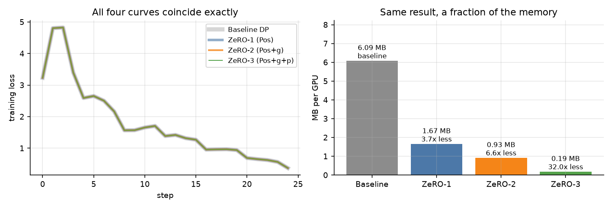
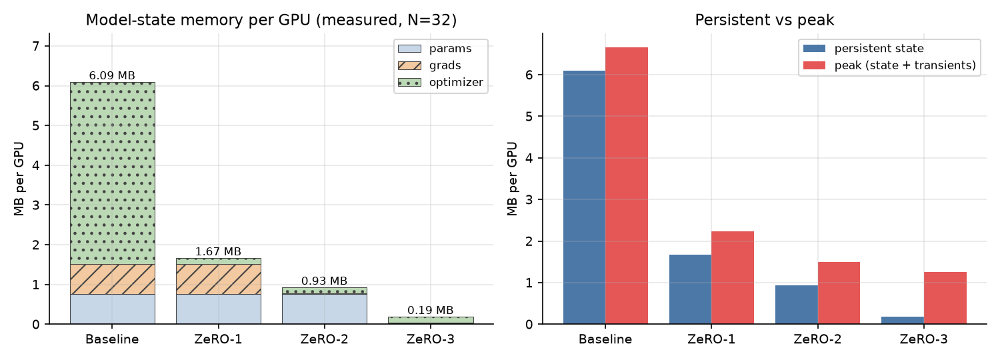
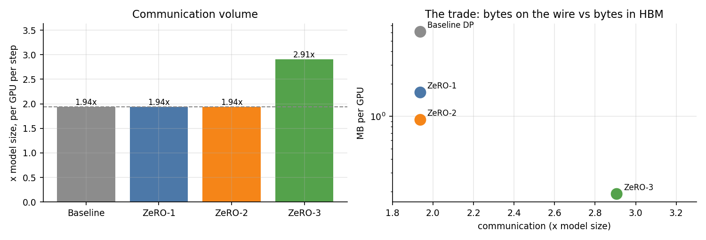
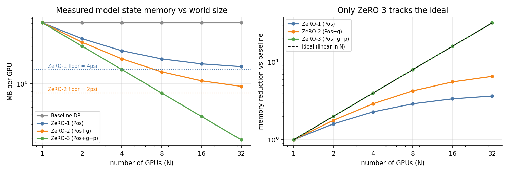
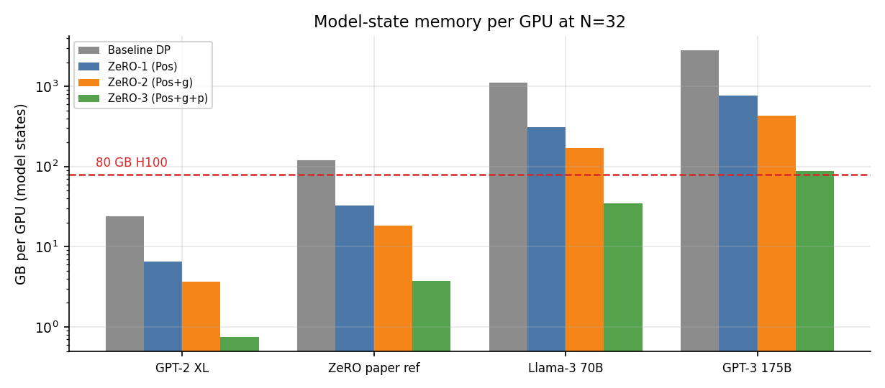

# ZeRO 1 / 2 / 3 on 32 Virtual GPUs

[](https://colab.research.google.com/github/abinesh1/ERAV5-S12/blob/main/ZeRO_32_GPU_Simulation.ipynb)

For this assignment I simulated DeepSpeed's ZeRO stages 1, 2 and 3 on 32 virtual GPUs. Everything is written from scratch in NumPy, so it needs no distributed runtime and no real GPU. I train the same small MLP four times: once with plain data parallelism, then once under each ZeRO stage. For each run I measure how much memory each GPU holds, the peak memory, how many bytes go over the "network", and how much compute each GPU does.

The main result is what ZeRO promises: all four runs produce exactly the same training run (bit for bit), but ZeRO-3 uses 32x less memory per GPU than the baseline.

Everything is in [`ZeRO_32_GPU_Simulation.ipynb`](ZeRO_32_GPU_Simulation.ipynb). It is self-contained, the outputs are committed, and it runs top to bottom in about a minute.

## Results

All numbers are for `N = 32` GPUs and a model with `Ψ = 399,370` parameters, trained with mixed-precision Adam.

| | Baseline DP | ZeRO-1 (P<sub>os</sub>) | ZeRO-2 (P<sub>os+g</sub>) | ZeRO-3 (P<sub>os+g+p</sub>) |
|---|---|---|---|---|
| Memory / GPU | 6.094 MB | 1.666 MB | 0.928 MB | 0.190 MB |
| Reduction vs baseline | 1.00x | 3.66x | 6.56x | 32.00x |
| Peak memory (incl. temporary buffers) | 6.658 MB | 2.230 MB | 1.493 MB | 1.256 MB |
| Communication / step | 1.94x | 1.94x | 1.94x | 2.91x |
| Matmul FLOPs / GPU / step | 76.5 M | 76.5 M | 76.5 M | 76.5 M |
| Adam updates / GPU / step | 399,392 | 12,481 | 12,481 | 12,481 |
| Final loss | 0.371121 | 0.371121 | 0.371121 | 0.371121 |

Communication is given as a multiple of the fp16 model size. It comes out at 1.94x and 2.91x instead of 2x and 3x because a ring collective only sends `(N-1)/N` of the data, and 31/32 = 0.969.



The left plot has four loss curves on it. I drew them with different line widths so you can see they sit exactly on top of each other: the difference from the baseline is 0.0 at every step for all three ZeRO stages.

## Where the 16Ψ comes from

With mixed-precision Adam, every parameter needs five tensors:

| tensor | dtype | bytes per parameter |
|---|---|---|
| parameters (compute copy) | fp16 | 2 |
| gradients | fp16 | 2 |
| parameters (fp32 master copy) | fp32 | 4 |
| Adam momentum `m` | fp32 | 4 |
| Adam variance `v` | fp32 | 4 |
| | | **16** |

In plain data parallelism every GPU keeps all 16Ψ bytes, so 32 GPUs hold 32 identical copies. Most of that is wasted. The Adam update is elementwise: the new value of parameter `j` only depends on `g[j]`, `m[j]`, `v[j]` and `master[j]`. So there is no reason for a GPU to store optimizer state for parameters it isn't updating.

ZeRO removes this duplication in three steps:

| stage | what gets sharded | memory / GPU | communication |
|---|---|---|---|
| Baseline DP | nothing | `16Ψ` | `2Ψ` |
| ZeRO-1 | optimizer states (12 bytes) | `4Ψ + 12Ψ/N` | `2Ψ` |
| ZeRO-2 | + gradients | `2Ψ + 14Ψ/N` | `2Ψ` |
| ZeRO-3 | + parameters | `16Ψ/N` | `3Ψ` |



The stacked bars show each step clearly. The optimizer states (green) are 75% of the baseline, and ZeRO-1 alone removes most of them. ZeRO-2 also shards the gradients, which leaves the 2Ψ of fp16 parameters as the remaining floor. ZeRO-3 shards those too.

Measured memory per GPU, by component (MB):

| | params | grads | optimizer | total |
|---|---|---|---|---|
| Baseline DP | 0.762 | 0.762 | 4.571 | 6.094 |
| ZeRO-1 | 0.762 | 0.762 | 0.143 | 1.666 |
| ZeRO-2 | 0.762 | 0.024 | 0.143 | 0.928 |
| ZeRO-3 | 0.024 | 0.024 | 0.143 | 0.190 |

## How the simulation works

### The 32 virtual GPUs

Each virtual GPU is a `VGPU` object that owns its own NumPy arrays. All 32 run one after another in a single process. They move in lockstep: every GPU finishes layer *i* before any GPU starts layer *i+1*, which is where a real collective would happen.

These parts are real:
- **The sharding.** Each GPU only allocates its own slice, and `state_bytes()` adds up the `.nbytes` of arrays that actually exist.
- **The collectives.** Data really is copied between the 32 separate arrays.
- **The byte counts and the arithmetic.**

What isn't real is running in parallel. Python threads wouldn't help, because the GIL runs them one at a time anyway, so any speedup number would be meaningless. Instead I report FLOPs and bytes communicated, which is what limits a real distributed run, and I don't claim any speedup.

### One flat parameter vector

As DeepSpeed does, I flatten all parameters into one buffer, pad it to a multiple of `N`, and shard that buffer: GPU `r` owns `[r·S, (r+1)·S)`. This keeps every shard the same size. The shard boundaries cut through the middle of layers, but that's fine, and it's also what DeepSpeed does.

```
Ψ = 399,370 params  ->  padded 399,392  ->  12,481 elements per GPU

  layer 0   256 x 512   flat[      0 : 131,584]   32.9% of the model
  layer 1   512 x 512   flat[131,584 : 394,240]   65.8% of the model
  layer 2   512 x  10   flat[394,240 : 399,370]    1.3% of the model
```

Each layer is still one contiguous chunk (a "bucket"), and buckets are what get all-gathered and reduce-scattered.

### Collectives and byte counting

| collective | result | bytes sent per GPU |
|---|---|---|
| `all_reduce(x)` | every GPU gets the mean | `2·(N−1)/N·size(x)` |
| `reduce_scatter(x)` | GPU `r` gets the mean, only for its shard | `(N−1)/N·size(x)` |
| `all_gather(shards)` | every GPU gets all the shards joined together | `(N−1)/N·size(out)` |

All reductions add up in fp32 in a fixed GPU order and round to fp16 at the end, in all four runs. Because of this, I can check that the runs are bit-for-bit identical.

### Where the stages differ

All the stage-specific logic is in two functions:

- **`layer_params(i)`** returns layer `i`'s weights.
  - Stages 0 to 2 already hold the full weights, so nothing is communicated.
  - Stage 3 has to all-gather the layer from all 32 shards, use it, and throw it away. It does this in the forward pass and again in the backward pass, which is where ZeRO-3's extra `Ψ` of communication comes from.
- **`deposit_grad(i)`** handles the gradient a GPU just computed.
  - Stages 0 and 1 store the whole thing.
  - Stages 2 and 3 reduce-scatter it right away and keep only their own slice, which is why their gradient memory is `Ψ/N` instead of `Ψ`.

Collectives per step, as counted by the notebook:

| | collectives per step | volume |
|---|---|---|
| Baseline DP | 1 all-reduce | `2Ψ` |
| ZeRO-1 | 1 reduce-scatter + 1 all-gather | `Ψ + Ψ` |
| ZeRO-2 | 3 reduce-scatters (one per layer) + 1 all-gather | `Ψ + Ψ` |
| ZeRO-3 | 6 all-gathers (3 forward + 3 backward) + 3 reduce-scatters | `Ψ + Ψ + Ψ` |

## Communication



ZeRO-1 and ZeRO-2 send exactly as many bytes as plain data parallelism. An all-reduce is really a reduce-scatter followed by an all-gather, and ZeRO just runs the optimizer step in between the two. So you get the memory savings without any extra communication.

ZeRO-3 is the only stage with a cost: 50% more communication in exchange for 32x less memory. On a real cluster, a lot of that extra traffic is hidden by prefetching layer `i+1` while layer `i` is computing.

## Computation

Matmul FLOPs per GPU are identical in all four runs (76.5 MFLOP per step, and the notebook asserts this). Every GPU still runs the full forward and backward pass on its own micro-batch, and nothing is recomputed. ZeRO moves the model state around, but it doesn't split the model's arithmetic. That is the main difference from tensor/model parallelism, which does split the arithmetic and therefore needs a very fast connection between GPUs. ZeRO's communication is mostly large bulk transfers, which work fine over ordinary networks between nodes.

The part of the computation that does change is the optimizer step. In plain data parallelism every GPU runs Adam on all `Ψ` parameters, so 32 GPUs do the same update 32 times. From ZeRO-1 onwards, each GPU only updates the `Ψ/N` slice whose optimizer state it holds:

| | Adam updates / GPU / step | total across 32 GPUs |
|---|---|---|
| Baseline DP | 399,392 (`Ψ`) | 12,780,544 (32 duplicate copies) |
| ZeRO-1 / 2 / 3 | 12,481 (`Ψ/N`) | 399,392 (each parameter updated once) |

Adam is elementwise (`O(Ψ)`), so it's small compared with the `6·B·Ψ` of the forward and backward pass. It's a side benefit rather than the main result, but the notebook measures it and checks it with an assert.

## Peak memory vs steady-state memory

ZeRO-3 only stores `16Ψ/N` between steps, but its peak is higher. To multiply by layer `i`, a GPU has to briefly hold all of layer `i`, not just its `1/N` slice:

```
peak ≈ 16Ψ/N  +  (largest layer)  +  (its gradient bucket)  +  activations
```

In this small model that temporary buffer dominates: the peak is 6.6x the steady-state memory, because the biggest layer is 65.8% of a 3-layer model, which is huge compared with 1/32 of it. This isn't a bug in the simulation. It's the reason real ZeRO-3 setups prefetch, split buckets into pieces smaller than a layer, and use activation checkpointing. It's also why ZeRO-3 helps more as models get deeper: in an 80-layer transformer one layer is about 1.25% of the model, not 66%.

I also measured activations (0.063 MB per GPU). They are the same in all four runs, because ZeRO shards model state, not activations. Reducing activation memory needs a different technique.

## Scaling with the number of GPUs



Memory per GPU in MB, measured by creating the GPUs at each size:

| N | Baseline | ZeRO-1 | ZeRO-2 | ZeRO-3 |
|---|---|---|---|---|
| 1 | 6.094 | 6.094 | 6.094 | 6.094 |
| 2 | 6.094 | 3.809 | 3.428 | 3.047 |
| 4 | 6.094 | 2.666 | 2.095 | 1.523 |
| 8 | 6.094 | 2.095 | 1.428 | 0.762 |
| 16 | 6.094 | 1.809 | 1.095 | 0.381 |
| 32 | 6.094 | 1.666 | 0.928 | 0.190 |

What the curves show:

- **Baseline:** flat. More GPUs give more throughput but no extra memory room.
- **ZeRO-1:** levels off at `4Ψ`, the parameters and gradients it still copies to every GPU.
- **ZeRO-2:** levels off at `2Ψ`.
- **ZeRO-3:** no floor. It follows the ideal `1/N` line, and it's the only stage where adding GPUs lets you train a bigger model rather than just train faster.

## What this means for real models

The notebook checks the paper's formulas against the measured memory at every GPU count above. Since they match, I used the formulas to estimate memory for models far too large to actually allocate here.

GB per GPU at `N = 32`, model states only (activations not included). For reference, an H100 has 80 GB, so anything above 80 doesn't fit.

| model | params | Baseline | ZeRO-1 | ZeRO-2 | ZeRO-3 |
|---|---|---|---|---|---|
| GPT-2 XL | 1.5B | 24 | 6.56 | 3.66 | 0.75 |
| ZeRO paper example | 7.5B | 120 | 32.8 | 18.3 | 3.75 |
| Llama-3 70B | 70B | 1120 | 306 | 171 | 35.0 |
| GPT-3 175B | 175B | 2800 | 766 | 427 | 87.5 |



- **7.5B:** needs 120 GB per GPU with plain data parallelism, which doesn't fit on any GPU. ZeRO-1 alone, with no extra communication, brings it down to about 33 GB, so it trains on 32 GPUs.
- **70B:** only fits with ZeRO-3, at 35 GB.
- **175B:** still doesn't fit at `N = 32`, even with ZeRO-3 (87.5 GB). You'd need more GPUs, since `16Ψ/N` keeps going down, or ZeRO-Infinity's offloading to CPU/NVMe. ZeRO-3 basically trades a memory problem for a bandwidth problem.

## Checking the results

A memory simulation is only meaningful if the training itself is still correct. The notebook has four asserts, and it stops with an error if any of them fails:

1. **Same training run.** All four runs, starting from the same seed with the same data, give identical loss curves (`max |loss − baseline| == 0.0`). If ZeRO-3 skipped a gather or the optimizer sharding was wrong, the curves would drift apart straight away.
2. **Measured memory matches the paper.** `state_bytes()` adds up real `.nbytes`, and each result must equal the paper's `16Ψ` / `4Ψ+12Ψ/N` / `2Ψ+14Ψ/N` / `16Ψ/N` exactly, to the byte.
3. **Same FLOPs.** Matmul FLOPs must be identical across stages, so no stage can save memory by quietly recomputing things.
4. **Optimizer work is sharded.** Each GPU's Adam step must touch exactly `Ψ` elements (baseline) or `Ψ/N` (all ZeRO stages).

```
max |loss - baseline|        ZeRO-1 (Pos) : 0.000e+00
max |loss - baseline|      ZeRO-2 (Pos+g) : 0.000e+00
max |loss - baseline|    ZeRO-3 (Pos+g+p) : 0.000e+00

            config     measured B      formula B   match
       Baseline DP      6,390,272      6,390,272   ok
      ZeRO-1 (Pos)      1,747,340      1,747,340   ok
    ZeRO-2 (Pos+g)        973,518        973,518   ok
  ZeRO-3 (Pos+g+p)        199,696        199,696   ok
```

## Running it

**Colab:** click the badge at the top; nothing needs installing.

**Locally:** the only dependencies are NumPy and Matplotlib.

```bash
pip install numpy matplotlib
jupyter notebook ZeRO_32_GPU_Simulation.ipynb
```

Run all cells. It takes about a minute on a CPU and saves the figures to `figures/`.

### Settings

All the settings are in one cell near the top:

```python
N_GPUS   = 32                                    # virtual GPUs
LAYERS   = [(256, 512), (512, 512), (512, 10)]   # MLP shape
GLOBAL_BATCH = 1024                              # -> 32 samples per GPU
STEPS    = 25
```

You can set `N_GPUS` to any value that divides `GLOBAL_BATCH`. A more interesting change is to make `LAYERS` deeper and narrower: that pulls ZeRO-3's peak down towards its `16Ψ/N` steady-state memory, which is closer to how real models behave.

## Files

```
ZeRO_32_GPU_Simulation.ipynb   the simulation, self-contained, outputs committed
figures/                       plots saved by the notebook (used in this README)
README.md
```

## Limitations

- **No real parallelism.** The GPUs run one after another, so I don't measure or claim any speedup. Bandwidth, latency and overlapping communication with compute aren't modelled either. A real ZeRO-3 run hides much of its extra `Ψ` behind compute through prefetching, so the real cost is less than the +50% shown here.
- **Activations aren't optimised.** I measure activation memory but don't reduce it. Activation checkpointing and ZeRO-R are out of scope, and on deep models activations often take more memory than anything ZeRO handles.
- **Features not included:** CPU/NVMe offload (ZeRO-Infinity), gradient accumulation, and tensor or pipeline parallelism.
- **Toy model.** It has only 3 layers, so a single layer is a big part of it, which makes ZeRO-3's peak memory look worse than it would for a deep transformer.
- **Estimated network traffic.** Communication volumes come from the standard `(N−1)/N` ring formulas applied to the real data sizes, not from simulating a real network.

## Reference

Rajbhandari, Rasley, Ruwase, He. *ZeRO: Memory Optimizations Toward Training Trillion Parameter Models.* SC'20. [arXiv:1910.02054](https://arxiv.org/abs/1910.02054)
